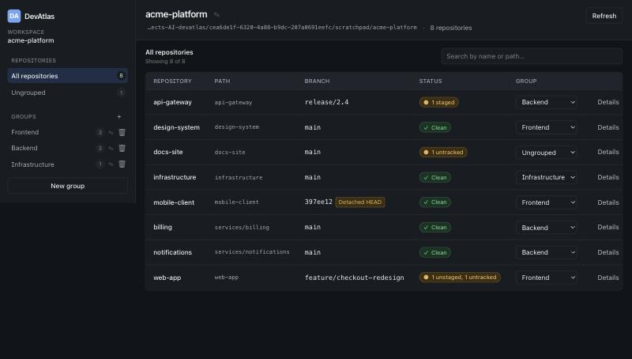
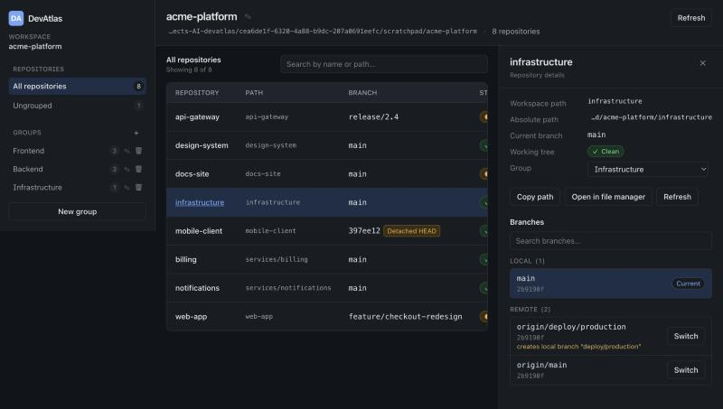
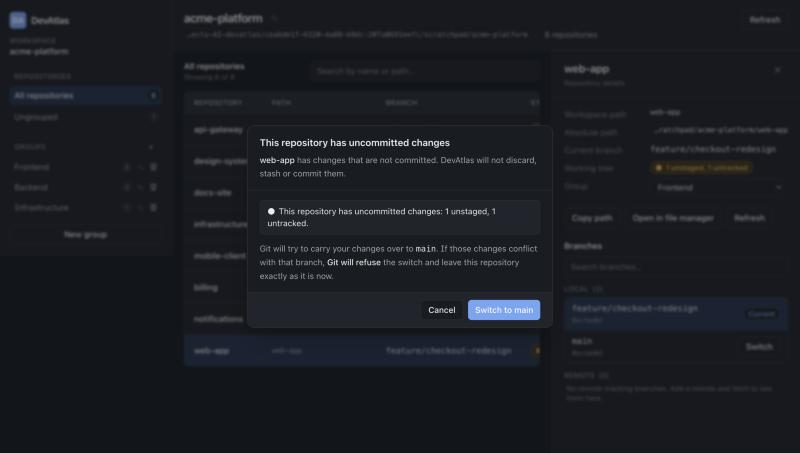

<div align="center">

# DevAtlas

**One place to see every Git repository in your workspace — their branches, their state, and whether you left something uncommitted.**

[](https://www.npmjs.com/package/devatlas)
[](https://nodejs.org)
[](#license)
[](#testing)

```bash
npx devatlas init
```

</div>



---

## The problem

You have a `work/` folder. Inside it are nine repositories — a web app, an API gateway, a couple of
services, infrastructure, some docs. To answer *"is everything committed?"* or *"which of these is
still on last sprint's branch?"* you `cd` into each one and run `git status`. Nine times.

DevAtlas answers both questions in one screen, and lets you switch branches without leaving it.

It runs entirely on your machine. No account, no server, no telemetry, nothing leaves your laptop.
It is a **read-and-switch** tool: it will never commit, merge, rebase, stash or discard anything
for you.

> DevAtlas is not an AI coding agent. It does not write code or replace your existing tools.

## Contents

- [Quick start](#quick-start)
- [What you get](#what-you-get)
- [CLI reference](#cli-reference)
- [How DevAtlas treats your repositories](#how-devatlas-treats-your-repositories)
- [Repository discovery](#repository-discovery)
- [Configuration files](#configuration-files)
- [Security model](#security-model)
- [Troubleshooting](#troubleshooting)
- [Architecture](#architecture)
- [Local HTTP API](#local-http-api)
- [Development](#development)
- [Testing](#testing)
- [FAQ](#faq)
- [Limitations](#limitations)

---

## Quick start

**Requirements:** Node.js ≥ 20.9 and `git` on your `PATH`. macOS, Linux or Windows.

Point DevAtlas at the folder that contains your repositories:

```bash
cd ~/work
npx devatlas init
```

That's the whole setup. DevAtlas will:

1. Mark `~/work` as a workspace by creating `.devatlas/`
2. Find every Git repository inside it
3. Start a local server on `http://127.0.0.1:4317`
4. Open your browser

```
DevAtlas

Initializing workspace...
Workspace: work
Path: /Users/you/work

Discovered 8 repositories.
Configuration created successfully.

Dashboard: http://127.0.0.1:4317

DevAtlas is running.
Press Ctrl+C to stop.
```

Next time, skip the setup:

```bash
npx devatlas start ~/work
```

You can also install it once instead of using `npx`:

```bash
npm install -g devatlas
```

---

## What you get

### A workspace at a glance

Every repository with its path, current branch and working-tree status. Search filters on **both**
names and paths, so typing `services/` narrows to just that subtree.

Status is always a symbol **and** words — `✓ Clean`, `● 1 staged`, `● 1 unstaged, 1 untracked` — so
it reads correctly without relying on colour. Detached HEADs and repositories with no commits yet
are labelled rather than shown as blanks.

### Repository details and branches



Click any repository for its paths, a breakdown of the working tree, and a searchable branch list
split into **Local** and **Remote**.

Remote branches with no local counterpart say so up front — `creates local branch "deploy/production"` —
so nothing surprising happens when you pick one. Remote branches you already track locally aren't
offered twice.

### Branch switching that cannot lose your work



If a repository is dirty, DevAtlas stops and explains the actual situation: Git will try to carry
your changes over, and **if they conflict, Git refuses and nothing moves**. When that happens you
see Git's own error message and your files are exactly as you left them.

DevAtlas does not offer to stash, discard or commit your way out of it. That's your call to make
in your own terminal.

### Your own groups

Create groups that match how you think — Frontend, Backend, Infrastructure, `team-a`, whatever —
and assign repositories to them. A repository belongs to at most one group; everything else sits
under **Ungrouped**. Deleting a group moves its repositories back to Ungrouped and never touches a
file.

Groups and the workspace name persist across restarts, and survive a repository temporarily going
missing.

---

## CLI reference

| Command | What it does |
| --- | --- |
| `devatlas init [path]` | Initialize a workspace and open the dashboard |
| `devatlas start [path]` | Start an existing workspace and open the dashboard |
| `devatlas help` | Show usage |
| `devatlas version` | Print the installed version |

`[path]` is optional and may be relative (`./my-project`), absolute, or use `~`. Omit it to use the
current directory.

| Option | Effect |
| --- | --- |
| `--port <number>` | Preferred port (default `4317`). If taken, the next free port is used. |
| `--no-open` | Don't open a browser. The URL is still printed. |
| `--no-start` | Set the workspace up and exit without starting the dashboard. For scripts and CI. |

```bash
devatlas init                          # current directory
devatlas init ./my-project             # relative path
devatlas start /srv/code --port 5000   # absolute path, custom port
devatlas init ~/work --no-start        # prepare only, no server, no browser
```

**`init` vs `start`.** `init` creates configuration if it's missing; running it on an existing
workspace keeps everything and just starts it. `start` deliberately refuses to initialize, so a
typo in a path can't scatter `.devatlas/` folders around your disk.

---

## How DevAtlas treats your repositories

This is the part worth reading before you trust it with your work.

**It never runs a destructive Git command.** No `git reset`, `clean`, `stash`, `commit`, `merge`,
`rebase`, `cherry-pick`, `revert` or `push`, and never `--force`. This isn't a convention — those
commands are rejected at the single function every Git call passes through, and a test asserts no
destructive invocation exists anywhere in the source, so it can't be reintroduced by accident.

In practice DevAtlas only ever runs:

```
git rev-parse …          git symbolic-ref …       git status --porcelain=v1 -z
git for-each-ref …       git switch <branch>      git switch --track <remote>/<branch>
```

**It never repairs your configuration behind your back.** If `.devatlas/config.json` or `data.json`
is damaged, DevAtlas reports the exact problem and stops. Nothing is overwritten, reset or deleted,
so you can fix it yourself.

**It remembers repositories that vanish.** An unmounted volume or a folder mid-move keeps its
record and its group assignment, marked unavailable, instead of being silently forgotten.

**It never renames your folders.** Renaming the workspace changes a display name in a JSON file.
Your directory keeps its name and its path.

**It never stores secrets.** No credentials, tokens, environment values or Git authentication
information is written anywhere. Git subprocesses run with credential prompts disabled, so no
operation can hang waiting on a password.

---

## Repository discovery

DevAtlas walks your workspace looking for Git repositories, then **asks Git to confirm** each
candidate with `git rev-parse --show-toplevel`. That confirmation is what makes the result
trustworthy:

- A subdirectory of a repository reports its parent as the top level, so it's rejected — you never
  get `my-app/src` listed as a repository.
- A leftover `.git` folder that isn't a real repository is skipped and reported as a warning.
- Results are deduplicated by canonical top-level path, so nothing appears twice.

It also handles the awkward cases:

| Case | Behaviour |
| --- | --- |
| Workspace root is itself a repository | Included, shown with path `.` |
| Repository nested inside another repository | Both listed — they're independent checkouts |
| Linked worktrees and submodules (`.git` *file*) | Recognized, not just `.git` directories |
| Symlink pointing outside the workspace | Not followed |
| Symlink cycle | Terminates safely |
| Unreadable directory | Recorded as a warning; the scan continues |
| `node_modules`, `.next`, `dist`, `build`, `coverage`, `.devatlas` | Skipped, at any depth |

Discovery descends up to **8 levels** below the workspace root. Press **Refresh** in the dashboard
to rescan — it's additive, so new repositories appear and your existing groups are untouched.

---

## Configuration files

Everything lives in a `.devatlas/` directory at the root of your workspace:

```
my-project/
├── web-app/
├── api-gateway/
├── services/
│   └── billing/
└── .devatlas/
    ├── config.json    workspace id, display name, root path
    ├── data.json      discovered repositories and your groups
    └── runtime.json   pid/port of the running instance (removed on exit)
```

<details>
<summary><strong>config.json</strong></summary>

```json
{
  "schemaVersion": 1,
  "workspaceId": "f231d941-4f84-4a52-863e-a31c9e51f514",
  "name": "acme-platform",
  "rootPath": "/Users/you/work",
  "createdAt": "2026-10-10T14:13:56.580Z"
}
```
</details>

<details>
<summary><strong>data.json</strong></summary>

```json
{
  "repositories": [
    {
      "id": "1cf387c012cd2d02",
      "name": "web-app",
      "absolutePath": "/Users/you/work/web-app",
      "relativePath": "web-app",
      "available": true,
      "lastSeenAt": "2026-10-10T14:13:56.780Z"
    }
  ],
  "groups": [
    {
      "id": "9622607d-f10d-425b-bc01-1d37e068cd7e",
      "name": "Frontend",
      "repositoryIds": ["1cf387c012cd2d02"],
      "createdAt": "2026-10-10T14:20:11.004Z"
    }
  ],
  "updatedAt": "2026-10-10T14:20:11.010Z"
}
```
</details>

A repository's `id` is derived from its workspace-relative path, so it stays stable across restarts
and rescans — which is what lets group assignments survive.

Live Git state is deliberately **never** written to disk. Branches and working-tree status are
always read from Git, never from a cache that could be wrong.

Both files are validated with Zod on every read and written atomically (temp file + `fsync` +
`rename`), so an interrupted write leaves the previous version fully intact rather than a truncated
one. Concurrent writes are serialized, so two browser tabs can't clobber each other.

Commit `.devatlas/` to share groups with your team, or add it to `.gitignore` to keep it personal.
Either works.

---

## Security model

DevAtlas binds to `127.0.0.1` and is not reachable from your network. Loopback binding alone is
**not** treated as a security boundary:

| Protection | What it stops |
| --- | --- |
| `Host` header must be a loopback hostname | DNS rebinding — an attacker's domain resolving to `127.0.0.1` arrives with *their* hostname |
| Same-origin `Origin` required on writes | A malicious page issuing cross-origin requests |
| `Sec-Fetch-Site` checked when present | Cross-site requests from a modern browser |
| Per-run CSRF token, double-submitted | A cross-site page can't read the token, so it can't forge a write |
| Repositories addressed by opaque id | The browser never sends a filesystem path at all |
| Path re-verified under the workspace root before every operation | A moved repository or planted symlink escaping the workspace |
| Every Git call uses `execFile` with an argument array | Shell injection — no shell is involved anywhere |

There is no general filesystem endpoint and no command-execution endpoint. The CSRF token is
regenerated each time the server starts.

---

## Troubleshooting

<details>
<summary><strong>"Git was not found on your PATH."</strong></summary>

Install Git from <https://git-scm.com/downloads>, then confirm `git --version` works in the *same*
terminal you run DevAtlas from.
</details>

<details>
<summary><strong>"No Git repositories were discovered."</strong></summary>

DevAtlas searches below the workspace directory, up to 8 levels deep, skipping `node_modules`,
`.next`, `dist`, `build`, `coverage` and `.devatlas`. Check you initialized the folder that
*contains* your repositories, not one of the repositories itself. Then press **Refresh**.
</details>

<details>
<summary><strong>Port 4317 is already in use</strong></summary>

DevAtlas moves to the next free port automatically and prints the real URL. It never kills whatever
is using the port. Use `--port <number>` to pick a different starting point.
</details>

<details>
<summary><strong>The browser didn't open</strong></summary>

Not fatal — the URL is in the terminal, open it manually. Use `--no-open` to skip the attempt.
</details>

<details>
<summary><strong>"This folder is not a DevAtlas workspace."</strong></summary>

Run `devatlas init` there first. `start` refuses to initialize on purpose.
</details>

<details>
<summary><strong>"… is not valid JSON."</strong></summary>

A file in `.devatlas/` is damaged. **DevAtlas has changed nothing.** Fix the reported file, or
delete it: deleting `data.json` loses your groups but is otherwise safe; deleting `config.json`
makes the directory uninitialized again.
</details>

<details>
<summary><strong>A repository shows as "Unavailable"</strong></summary>

Its directory was moved, deleted, or can't be read. Its group assignment is kept. Restore the
directory and press **Refresh**.
</details>

<details>
<summary><strong>A branch switch failed</strong></summary>

Git refused because your local changes would be overwritten — the error shown is Git's own. Your
work is untouched. Commit or stash it yourself, then try again.
</details>

<details>
<summary><strong>"DevAtlas is already running for this workspace."</strong></summary>

A healthy instance is already serving it. DevAtlas opens that one instead of starting a second.
If the previous instance crashed, delete `.devatlas/runtime.json` and try again.
</details>

---

## Architecture

A Next.js app and a CLI sharing one library. No database, no Docker, no services.

```
devatlas/
├── bin/devatlas.js              #!/usr/bin/env node shim → dist/cli
├── src/
│   ├── cli/                     arg parsing, init/start, port selection, server launch
│   ├── lib/
│   │   ├── config/              path resolution and containment checks
│   │   ├── discovery/           filesystem walk + Git validation
│   │   ├── git/                 exec guard, output parsers, repository operations
│   │   ├── persistence/         atomic writes, per-file locking
│   │   ├── workspace/           store, service layer, active workspace
│   │   ├── security/            request guard, API responses
│   │   └── validation/          Zod schemas (single source of truth for types)
│   ├── app/                     layout, page, 11 API route handlers
│   ├── components/              layout, workspace, repositories, branches, groups, ui
│   └── types/
├── tests/{unit,integration,helpers}/
└── scripts/postbuild.mjs
```

**Everything in `src/lib` is used by both the CLI and the server.** The CLI bundles it with tsup;
Next compiles it for the route handlers. No logic is written twice.

**How the CLI launches the app.** `next build` runs with `output: 'standalone'`, producing a
self-contained `.next/standalone/server.js`. The CLI spawns it as a child process, passing the
workspace root and a fresh CSRF secret through the environment, polls `/api/health` until it reports
the right workspace id, *then* opens the browser. The package root is resolved from
`import.meta.url`, never `process.cwd()`, so the CLI finds its own bundle from any directory.

**Why the workspace comes from the environment.** The server is pinned to exactly one workspace at
launch. There is no request that can point it somewhere else.

---

## Local HTTP API

The dashboard is a normal client of this API. Every route validates its input with Zod and runs the
request guard described in [Security model](#security-model).

| Route | Method | Purpose |
| --- | --- | --- |
| `/api/health` | `GET` | Readiness probe, returns the workspace id |
| `/api/workspace` | `GET` `PATCH` | Read details; rename (trims, rejects empty) |
| `/api/repositories` | `GET` | List with live branch + status (`?force=1` bypasses the cache) |
| `/api/repositories/refresh` | `POST` | Rescan the filesystem, merge additively |
| `/api/repositories/[id]` | `GET` | One repository with live state |
| `/api/repositories/[id]/branches` | `GET` | Local + remote branches, upstreams |
| `/api/repositories/[id]/branches/switch` | `POST` | `{ branch, kind, confirmDirty? }` |
| `/api/repositories/[id]/reveal` | `POST` | Open in the system file manager |
| `/api/groups` | `GET` `POST` | List; create |
| `/api/groups/[id]` | `PATCH` `DELETE` | Rename; delete (members → Ungrouped) |
| `/api/groups/assign` | `PATCH` | `{ repositoryId, groupId \| null }` |

Errors use a stable shape with a machine-readable code:

```json
{ "error": { "code": "GIT_REFUSED", "message": "Git did not switch …", "detail": "error: Your local changes…" } }
```

**Branch switching** is a two-step handshake. A dirty repository returns
`{ "outcome": "needs-confirmation", "status": … }` rather than acting. The client shows the dialog
and resends with `confirmDirty: true`. The server re-reads the branch list and working tree
immediately before switching either way, so a branch deleted or a file edited since the page loaded
is caught rather than acted on blindly.

Working-tree status is cached for 3 seconds and invalidated by Refresh and after every switch.

---

## Development

```bash
git clone <your-fork> devatlas
cd devatlas
npm install
```

| Script | What it does |
| --- | --- |
| `npm run dev` | Next dev server on `http://127.0.0.1:4317` (uses the current directory as the workspace) |
| `npm run build` | Production app bundle + CLI bundle |
| `npm run lint` | ESLint |
| `npm run typecheck` | `tsc --noEmit` |
| `npm test` | Full suite |
| `npm run test:watch` | Vitest in watch mode |

To try the real CLI against a scratch workspace while developing:

```bash
npm run build && node bin/devatlas.js init /tmp/scratch-workspace
```

**Stack:** Next.js 16 (App Router) · React 19 · TypeScript (strict) · Tailwind CSS 4 · Zod 4 ·
Vitest 5 · tsup. Tailwind 4 uses CSS-first configuration, so the design tokens live in
`src/app/globals.css` rather than a `tailwind.config.ts`.

---

## Testing

```bash
npm run build   # integration tests boot the packaged server
npm test
```

**121 tests across 7 files**, all against disposable Git repositories created in temporary
directories with their own `GIT_CONFIG_GLOBAL`. Nothing ever runs against a real repository.

| File | Tests | Covers |
| --- | --- | --- |
| `unit/discovery.test.ts` | 19 | Nested repos, worktrees, symlink cycles, skipped dirs, detached/unborn HEAD |
| `unit/git-safety.test.ts` | 18 | Destructive commands rejected; source scanned for any that slipped in |
| `unit/persistence.test.ts` | 17 | Atomic writes, file locking, damaged configs left intact, id stability |
| `unit/paths.test.ts` | 12 | Containment (including the `/ws` vs `/ws-evil` prefix trap), escaping symlinks |
| `unit/parse.test.ts` | 8 | Porcelain parsing incl. renames, branch listing, remote-only detection |
| `integration/api.test.ts` | 31 | Every endpoint over HTTP against the real packaged server |
| `integration/cli.test.ts` | 16 | Both init modes, config preservation, port fallback, packaging |

The one worth reading is in `integration/api.test.ts`: it sets up a conflicting uncommitted change,
confirms the switch, asserts Git refuses, and then asserts the file is **byte-for-byte identical**
and that no stash was created.

---

## FAQ

**Does it modify my repositories?**
Only by checking out a branch you explicitly click, using `git switch`. Nothing else.

**Can I use it on a server or share the URL?**
No — it binds to loopback only, by design. It's a single-user local tool.

**Does it work offline?**
Entirely. It never makes a network request. Even remote branches come from refs already fetched
into your local clone; DevAtlas doesn't fetch.

**Can I manage several workspaces at once?**
Run `devatlas start` in each one — they'll pick separate ports. One workspace per instance is a V1
constraint.

**Why is `.next/standalone` in the published package?**
It's the compiled application. Shipping it is what lets `npx devatlas` work without a build step
or a dev server on your machine.

**Will it push, pull or fetch?**
No. DevAtlas reads your repositories and switches branches. Anything that talks to a remote, or
that rewrites history, stays in your terminal where you can see it.

---

## Limitations

- One workspace per running instance; no in-app workspace switching.
- Discovery descends at most 8 levels below the workspace root.
- Working-tree status is cached for 3 seconds between refreshes, so a change made in another window
  may take a moment to appear. **Refresh** forces an immediate re-read.
- The layout is desktop-first. It works at phone width, but the sidebar stacks above the table.
- No fetch/pull, so remote branches reflect your last `git fetch`.

## License

MIT
